  <a href="https://kyraagent.xyz">
    <picture>
      <source media="(prefers-color-scheme: dark)" srcset="docs/assets/readme/kyra-hero-dark.svg" />
      
    </picture>
  </a>

  
  
  

  <a href="https://kyraagent.xyz">Website</a> &middot;
  <a href="https://kyraagent.xyz/try">Try it</a> &middot;
  <a href="https://x.com/Kyra_Agent">X</a> &middot;
  <a href="CHANGELOG.md">Changelog</a> &middot;
  <a href="docs/README.md">Docs</a>

---

**Kyra Agent** lets anyone deploy an AI agent that lives in Telegram, keeps its
records in a private dashboard, and prepares Robinhood Chain actions that only
the owner's wallet can sign. The agent explains, checks, and plans. It never
holds keys and never moves funds on its own.

## How it works

<picture>
  <source media="(prefers-color-scheme: dark)" srcset="docs/assets/readme/kyra-approval-flow-dark.svg" />
  
</picture>

| Step | What happens |
| --- | --- |
| **1. Deploy** | Pick a template, name the agent, publish its profile. Records stay in your private workspace (up to 3 agents). |
| **2. Connect Telegram** | Paste a BotFather token during deploy or later from the dashboard. It is stored backend-only and never returned to the browser. |
| **3. Talk to it** | Open the one-time link, press Start, and chat. Replies are read-only and always in English. |
| **4. Approve in your wallet** | Onchain actions become reviews in the dashboard. Nothing is sent until you sign in your wallet. |

## Talk to your agent

<table>
  <tr>
    <td width="52%" valign="top">
      <picture>
        <source media="(prefers-color-scheme: dark)" srcset="docs/assets/readme/kyra-telegram-demo-dark.svg" />
        
      </picture>
    </td>
    <td valign="top">

| Command | Purpose |
| --- | --- |
| `/start` | Link your private chat, or show help |
| `/help` | Commands and examples |
| `/status` | Session and execution boundary |
| `/agent` | The deployed role and focus |
| `/actions` | Read-only vs. approval-required actions |
| `/modules` | The template's module stack |
| `/policy` | The wallet and onchain safety rules |

Plain-text questions get a reply from the agent brain, scoped to the deployed
template. Wallet questions are answered honestly (Telegram cannot see live
balances), and any request to swap, send, approve, or sign is refused with a
pointer to the dashboard. Try the same rules live at
[kyraagent.xyz/try](https://kyraagent.xyz/try).

</td>
  </tr>
</table>

## Templates and modules

| Template | Built for |
| --- | --- |
| Operator | Personal wallet readiness and action reviews |
| Scout | Launch monitoring and recon |
| Steward | Projects and communities |
| Executor | Rule-based action readiness |
| Strategist | Market and campaign intelligence |
| Custom | Your own workflow and limits |

Behind every template runs the same five-module core:
**NIRA-01** lead orchestration · **VEXA-02** recon · **ASTRA-03** research ·
**NOVA-04** data · **NYX-05** security guard.

## Safety model

> Kyra plans. Your wallet decides.

- **No custody.** No seed phrases, no private keys, no hidden signing.
- **Telegram is read-only.** It cannot sign, approve, or submit anything.
- **Secrets are refused first.** Keys, tokens, and seed phrases pasted into chat
  are blocked before any model or service sees them.
- **Owner-only chat.** Only the linked owner chat receives replies.
- **Fail closed.** Account, wallet, chain, agent, and approval drift stops the flow.
- **Private by default.** Bot tokens, sessions, and wallet internals never reach
  public profiles or the browser.

## Robinhood Chain

Users connect a compatible EVM wallet in their private dashboard, review each
prepared action, and stay the final signer. The live transaction lane covers
owner-approved native ETH transfers with a `0.005 ETH` per-action cap and a
`0.02 ETH` daily cap per workspace, plus exact receipt verification.

The previous KYRA token contract is retired: every KYRA transfer and swap path
stays locked until a new official contract is announced on Kyra's channels.
Protected swaps (T2) are built and verified but remain default-off. See the
[Transaction Expansion Roadmap](docs/transaction-expansion-roadmap.md).

Kyra is an independent product and does not imply affiliation with,
sponsorship by, or endorsement from Robinhood.

## Status

**Relaunched in October 2026** and live at [kyraagent.xyz](https://kyraagent.xyz):
fresh backend, all 15 Edge Functions redeployed, end-to-end Telegram verified,
and a new interactive interface. Details in the
[Robinhood Chain Relaunch Runbook](docs/robinhood-relaunch-runbook.md) and the
[Changelog](CHANGELOG.md).

## Stack

| Layer | Technology |
| --- | --- |
| Frontend | React 18, Vite, TypeScript, wagmi + viem |
| Backend | Supabase Postgres with row-level security, 15 Deno Edge Functions |
| Agent brain | Backend-only LLM via OpenRouter, validated before delivery |
| Hosting | Netlify with a strict Content Security Policy |

## Documentation

- [Engineering documentation index](docs/README.md)
- [Robinhood Chain Relaunch Runbook](docs/robinhood-relaunch-runbook.md)
- [Transaction Expansion Roadmap](docs/transaction-expansion-roadmap.md)
- [Protected Swap Qualification Runbook](docs/protected-swap-qualification-runbook.md)
- [Product Readiness Snapshot](docs/product-readiness-snapshot.md)
- [v1.0.0 Release Notes](docs/release-v1.0.0.md)

Built for Robinhood Chain &middot; <a href="https://kyraagent.xyz">kyraagent.xyz</a> &middot; <a href="https://x.com/Kyra_Agent">@Kyra_Agent</a>

